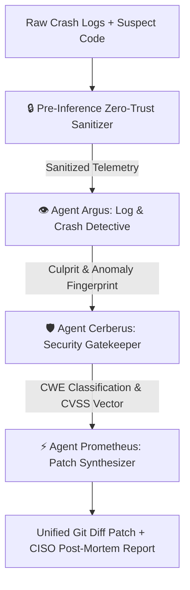

<div align="center">

# 🛡️ GhostAudit
### *Air-Gapped Autonomous Security & Supply-Chain Forensics Copilot*
**Powered by Google Gemma (2B / 9B / CodeGemma)**

[](https://opensource.org/licenses/MIT)
[](https://ai.google.dev/gemma)
[](https://github.com)
[](https://www.python.org/)

*Triaging zero-day leaks, production crashes, and supply-chain exploits at 3 AM without ever exposing proprietary code or credentials to external clouds.*

</div>

---

## 📌 The Problem: The Cloud LLM Privacy Trap

When a critical incident strikes production—a memory dump, unhandled authentication bypass, or suspected zero-day—engineering teams need immediate intelligence. 

However, **strict corporate data governance and legal compliance forbid feeding private stack traces, memory dumps, and proprietary codebases to closed cloud LLMs (OpenAI, Anthropic)**. One slip can leak proprietary intellectual property, customer PII, or internal credentials.

## 💡 The Solution: GhostAudit

**GhostAudit** is an air-gapped, multi-agent autonomous forensics copilot that runs **100% locally on your machine using Google Gemma**. It orchestrates three specialized mythological agents to investigate, audit, and patch vulnerabilities in seconds with zero telemetry egress.



---

## 🏛️ The Tri-Agent Architecture

GhostAudit divides cognitive forensics across three dedicated local Gemma personas:

### 1. 👁️ Argus (The All-Seeing Log Observer)
* Ingests crash dumps, syslog streams, and container logs.
* Pinpoints exact microsecond failure timestamps and culprit stack trace line numbers.
* Isolates malicious injection payloads (SQLi tokens, JNDI lookups, binary headers).

### 2. 🛡️ Cerberus (The Security & Code Gatekeeper)
* Audits the source code surrounding the failure site identified by Argus.
* Maps the flaw to formal **CWE (Common Weakness Enumeration)** standards.
* Calculates precise **CVSS v3.1** exploit severity ratings and detects leaked credentials.

### 3. ⚡ Prometheus (The Healer & Patch Synthesizer)
* Generates a surgical, production-ready **Unified Git Diff Patch (`.patch`)**.
* Formulates a step-by-step remediation plan and defense-in-depth architectural hardening guidelines.

---

## 🚀 Quickstart Guide

### 1. Clone & Install Dependencies
```bash
git clone https://github.com/your-username/ghostaudit.git
cd ghostaudit
python -m pip install -r requirements.txt
```

### 2. Run Local Gemma (via Ollama)
GhostAudit connects directly to your local Ollama instance:
```bash
ollama run gemma2:2b
# Or gemma2:9b / codegemma
```
> **Note for Judges**: If running on a lightweight machine without GPU or Ollama, GhostAudit includes an intelligent **Zero-Setup Sandbox Fallback** so all tests, CLI flows, and UI features can be evaluated instantly!

### 3. Launch the Cyber-Forensics Web Console
```bash
streamlit run ghostaudit/ui/app.py
```

### 4. Or Run via CLI
```bash
# Instant demo on SQL Injection incident
python ghostaudit/cli.py demo --scenario 1_sql_injection_auth_bypass

# Test Remote Code Execution (RCE) incident
python ghostaudit/cli.py demo --scenario 2_rce_insecure_deserialization
```

---

## 🔒 Defense-in-Depth: Pre-Inference Sanitizer

Before feeding raw incident data to any LLM prompt, GhostAudit's **Pre-Inference Sanitizer** scrubs:
- AWS / Cloud Secret Keys (`AKIA...`, `sk_live_...`)
- JSON Web Tokens (`eyJ...`)
- Private RFC-1918 IP addresses (`10.x.x.x`, `192.168.x.x`)
- Authorization Bearer tokens

This guarantees absolute data sovereignty and air-gapped safety.

---

## 🧪 Automated Test Suite
Run the comprehensive test suite verifying the multi-agent pipeline and sanitization engine:
```bash
python -m pytest ghostaudit/tests/test_core.py -v
```

---

## 🏆 DEV Challenge Alignment: Why Gemma Matters

* **Local Sovereignty**: GhostAudit demonstrates why open-weight models like **Google Gemma** are critical for cybersecurity and infrastructure protection.
* **Compact & High Performance**: Gemma 2B and 9B deliver fast inference on consumer laptops, making emergency forensics accessible to solo devs and Fortune 500 incident responders alike.

---

## 📄 License
Released under the [MIT License](LICENSE).
